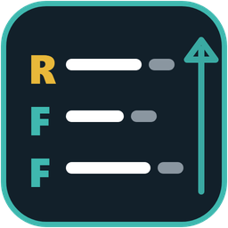
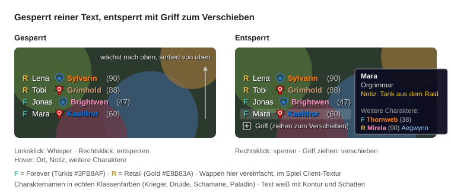

# FriendsListList

A minimal list of your online friends for World of Warcraft Forever. It shows only friends who are online and playing WoW Retail or WoW Forever, as plain text without frames. The list grows from the bottom up.

## Features

- Battle.net friends playing Retail (`R`, gold) or Forever (`F`, teal)
- Faction crest, character name in class color, level
- Sorted top to bottom: Retail first, then Forever, each by friend name
- Hover tooltip: friend name, location (zone/dungeon) and your Battle.net note
- Left click on a row: whisper. Right click: lock or unlock
- Unlocked: a small handle appears, drag it to move the list. Position is saved
- Optional: character friends of the classic friends list (`/fll chars`)
- English and German (deDE) text

## Installation

1. Download or clone this repository.
2. Copy the folder into your AddOns directory, named `FriendsListList`:
   `World of Warcraft\_forever_\Interface\AddOns\FriendsListList`
3. Restart the game or reload the UI (`/reload`).

The `.toc` targets Interface `16001`. The `docs` folder is not needed in the game.

## Usage

| Command | Description |
| --- | --- |
| `/fll` | Lock or unlock the list |
| `/fll chars` | Show or hide character friends (default: hidden) |
| `/fll reset` | Reset the position to the screen center |
| `/fll debug` | Toggle debug output in chat (default: on in 1.0) |
| `/fll dump` | Print raw data of all online friends, useful for bug reports |
| `/fll icon <n>` | Choose a faction icon variant (0 = automatic) |
| `/fll help` | Show the command list |

If the list is empty and locked, nothing is visible. Type `/fll` to unlock it and show the handle.

## Feedback

This is a first version. Please send the chat output with debug on, plus the result of `/fll dump`, for anything that looks wrong: missing friends, wrong faction icons, empty fields.

## Docs

The product and technical concept is in [docs/konzept.md](docs/konzept.md) (German).

## License

Copyright (c) 2026 neXter. All Rights Reserved. See [LICENSE](LICENSE).

You may download and use the add-on unmodified for personal, non-commercial use. Any copying, modification, or redistribution requires written permission from the author.

## Author

neXter
