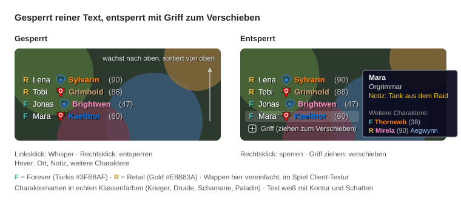

# FriendsListList – Konzept (WoW Forever Add-on)

Stand: 2026-11-09 · Pieter Walsweer

## Produktziel & Scope

FriendsListList ist eine schlanke Liste ohne Rahmen. Sie zeigt nur die Freunde, die gerade online sind und WoW Retail oder WoW Forever spielen. Das Add-on läuft ausschließlich im WoW-Forever-Client.

**Drin:**

- Battle.net-Freunde (RealID/BattleTag), deren aktives Spiel Retail oder Forever ist
- Optional per Befehl `/fll chars` (Standard: aus): Charakterfreunde der klassischen Freundesliste (nur Forever, da gleicher Client)
- Klick-Whisper, Lock/Unlock, frei verschiebbar, Position wird gespeichert
- Tooltip beim Hover mit Ort (Zone/Dungeon) und Notiz zum Freund (die Notiz hilft bei BattleTag-Freunden ohne RealID, deren Namen nichts verraten)
- Merkt sich die Charaktere, auf denen ein Freund schon gesehen wurde, und zeigt die anderen im Tooltip (`/fll forget` löscht sie)
- Gilde pro Charakter im Tooltip: Keine Freunde-API liefert sie, deshalb schlägt das Add-on sie beim Hover per `/who` nach und merkt sie sich (`/fll guild` schaltet das ab)

**Nicht drin:** Offline-Freunde, andere Spiele (Diablo, Overwatch, Classic Era usw.), Optionsmenü, Notizen bearbeiten, Gruppen, Sortier-Einstellungen, Minimap-Button.

## Mini-Mock



Von oben nach unten stehen erst die Retail-Freunde (Lena, Tobi), dann die Forever-Freunde (Jonas, Mara), jeweils alphabetisch. Alle haben ein Fraktionswappen. Ein türkises F markiert Forever, ein goldenes R markiert Retail. Rechts zeigt der Tooltip Gilde, Ort, Notiz und weitere Charaktere zu Mara. Die Wappen sind im Mock vereinfacht nachgezeichnet. Alle Namen sind Beispiele.

## Anzeige-Regeln

Eine Zeile pro Freund. Die Felder werden nur durch Leerzeichen getrennt, ohne Spaltenköpfe, Rahmen oder Hintergrund. Damit der Text auf der bunten Spielwelt lesbar bleibt, hat jede Zeile eine dünne schwarze Kontur und einen schwarzen Schatten.

| Feld | Forever-Freund | Retail-Freund | Darstellung |
| --- | --- | --- | --- |
| Spiel-Marker | F in Türkis (`#3FB8AF`) | R in Gold (`#E8B83A`) | fetter Buchstabe am Zeilenanfang |
| Freundesname | ja | ja | weiß. RealID-Freunde: Name wie im Spiel (geschützter Token, der Client zeigt in der Liste den echten Namen). Reine BattleTag-Freunde: BattleTag ohne `#Nummer`. Mit `/fll names` immer der BattleTag |
| Fraktion | ja | ja | Horde- bzw. Allianz-Wappen, 14 px, direkt vor dem Charakternamen |
| Charaktername | ja | ja | Klassenfarbe |
| Level | ja | ja | grau, in Klammern hinter dem Charakternamen |
| Ort (Zone/Dungeon) | Tooltip | Tooltip | nicht in der Zeile, damit die Liste schmal bleibt |

```
R  Lena   [Allianz-Wappen] Sylvarin (90)
R  Tobi   [Horde-Wappen] Grimhold (88)
F  Jonas  [Allianz-Wappen] Brightwen (47)
F  Mara   [Horde-Wappen] Kaelthor (60)   ← Anker unten
```

**Sortierung:** Gelesen von oben nach unten stehen erst alle Retail-Freunde (R), dann alle Forever-Freunde (F). Innerhalb jeder Gruppe wird alphabetisch nach BattleTag sortiert, weil der echte Name eines RealID-Freundes ein geschützter Wert ist und sich nicht sortieren lässt. Die Liste wächst von unten nach oben: Der Anker sitzt unten, neue Zeilen schieben die Liste nach oben. Die letzte Zeile der Sortierung liegt deshalb direkt am Anker. Technisch bekommt die letzte Zeile der sortierten Liste `rows[1]`, die erste Zeile den höchsten Index.

**Charakterfreunde** (klassische Freundesliste, ohne Battle.net) erscheinen nur nach `/fll chars`, Standard ist aus. Sie zeigen F, Charaktername und Level, aber keinen Freundesnamen. Der Ort steht wie bei allen im Tooltip. Die Fraktion fehlt, weil die klassische Freundesliste sie nicht liefert.

**Tooltip:** Beim Hover über eine Zeile erscheint ein Tooltip mit bis zu fünf Zeilen, dazu optional einem Block mit weiteren Charakteren (Punkt 6):

1. Freundesname (weiß, fett)
2. Gilde des Charakters als `<Gildenname>` (grün), nur wenn bekannt. Beim ersten Hover fehlt die Zeile und erscheint nach etwa einer Sekunde, sobald die `/who`-Antwort da ist (siehe „Gildensuche“)
3. Ort des Charakters: Zone, Dungeon oder Schlachtfeld, ungekürzt (hellgrau)
4. Server (hellblau): bei Retail-Freunden Servername und, wenn bekannt, Realm-Typ, z. B. `Ravencrest (RP-PvE)`. Bei Forever-Freunden nur der Realm-Typ (`PvP`, `PvE`, `RP`, `RP-PvP`, `RP-PvE`). Der Typ wird aus der Rich Presence gelesen (`Forever - PvP - The Barrens`), ersatzweise aus dem Realm-Namen (`CAMWOW EU5 Realm 3 PvE`), der Servername aus `realmName`/`realmDisplayName`. Der Typ ist farbig: PvE grün, PvP rot, RP-PvE dunkelgrün, RP-PvP dunkelrot (`RP` allein zählt als RP-PvE). Fehlt eine Angabe, entfällt die Zeile.
5. Notiz aus der Freundesliste (gelb), nur wenn eine gepflegt ist
6. Weitere Charaktere (nur wenn der Freund schon auf anderen Charakteren gesehen wurde): Leerzeile, Überschrift „Weitere Charaktere:“ (grau), dann je Charakter eine Zeile mit F/R-Marker, Name in Klassenfarbe, Level in Klammern und bei Retail-Charakteren dem Servernamen (hellblau), bei Forever-Charakteren dem Modus (PvE, PvP, RP, RP-PvP, RP-PvE, farbig wie in Zeile 4), weil Forever keine Realms hat. Danach, wenn gemerkt, die Gilde des Charakters in dunklerem Grün. Zuletzt gesehene Charaktere stehen oben, maximal 6, darunter „+N weitere“.

Die Notiz wird in WoW gepflegt, das Add-on liest sie nur.

**Gemerkte Charaktere:** Bei jedem Refresh speichert das Add-on für jeden online gesehenen Battle.net-Freund den aktuellen Charakter (Name, Klasse, Level, F/R, Realm, Modus, Zeitpunkt). Schlüssel ist der BattleTag des Freundes, weil er der einzige stabile Bezeichner ist. Innerhalb eines Freundes ist ein Charakter über Spiel + Name eindeutig. Der Realm wird absichtlich nicht in den Schlüssel genommen, weil er nicht immer sofort mitkommt und sonst Dubletten entstehen. Pro Freund bleiben höchstens 10 Charaktere erhalten, danach fliegt der am längsten nicht gesehene raus. Der Charakter, auf dem der Freund gerade ist, steht nicht in der Liste. Charakterfreunde der klassischen Freundesliste haben keinen BattleTag und werden nicht gespeichert. Die Klasse wird als `classFile` abgelegt, damit die Farbe auch nach einem Sprachwechsel stimmt. Kommt ein Feld leer an (Klasse, Level, Realm, Modus, etwa kurz nach dem Login oder projektübergreifend), bleibt der gespeicherte Wert stehen. Gesehen werden kann nur, was der Freund schon online gespielt hat, während das Add-on lief: Eine Historie vor der Installation gibt es nicht.

**Gildensuche:** Weder `C_BattleNet.GetFriendGameAccountInfo` noch `C_FriendList.GetFriendInfoByIndex` liefern eine Gilde, nur `/who` (`C_FriendList.SendWho`, Ergebnis `C_FriendList.GetWhoInfo(i).fullGuildName` nach `WHO_LIST_UPDATE`). Ablauf:

- `OnEnter` einer Forever-Zeile (`game == "F"`, mit Charaktername) stellt eine Anfrage `n-"Name"` in eine Warteschlange, wenn der Cache nicht frisch ist. Retail-Freunde werden nicht abgefragt, weil sie aus Forever per `/who` nicht sichtbar sind.
- Gedrosselt: höchstens eine Anfrage gleichzeitig, mindestens 6 s Abstand, höchstens 5 wartende Anfragen (der zuletzt überfahrene Freund kommt zuerst). Kein Antwort-Event nach 8 s gilt als erfolglos.
- Vor dem Senden `C_FriendList.SetWhoToUi(true)` (kein Chat-Echo) und das Blizzard-`FriendsFrame` hört währenddessen nicht auf `WHO_LIST_UPDATE` (wie LibWho), damit sich kein Fenster öffnet. Danach wird der Event wieder registriert und `SetWhoToUi(false)` gesetzt. Ist der Who-Reiter gerade offen, sendet das Add-on nichts.
- Die Antwort wird nach Namen geprüft. Liefert `/who` Treffer, aber nicht unseren Charakter (etwa eine manuelle Suche des Spielers), wird sie ignoriert. Null Treffer (Charakter offline oder nicht gefunden) gilt als „nicht gefunden“.
- Cache: `db.guilds["F:name"] = { guild, seen, tried }`, höchstens 300 Einträge (der älteste fliegt raus). Bekannte Gilde oder „keine Gilde“ gilt 24 h, ein erfolgloser Versuch 10 min. Eine bekannte Gilde wird nach erfolgloser Suche nicht gelöscht. Der Cache gilt je Charaktername, deshalb erscheint die Gilde auch bei den weiteren Charakteren, sobald dieser Charakter einmal online abgefragt wurde. Offline-Charaktere können nicht abgefragt werden.
- `/fll guild` schaltet die Suche ab (Standard: an), `/fll forget` löscht auch den Gilden-Cache.

**Leere Liste:** Gesperrt ist nichts zu sehen. Entsperrt ist nur der Verschiebe-Griff sichtbar.

## Interaktion

| Aktion | Wo | Ergebnis |
| --- | --- | --- |
| Linksklick | Zeile | Öffnet einen Whisper: Battle.net-Whisper für BNet-Freunde, Charakter-Whisper für Charakterfreunde |
| Hover | Zeile | Tooltip mit Ort und Notiz zum Freund |
| Rechtsklick | beliebige Zeile | Wechselt zwischen gesperrt und entsperrt |
| Rechtsklick | Griff | Sperrt wieder |
| Ziehen | Griff (nur entsperrt) | Verschiebt die Liste, die Position wird gespeichert |
| `/fll` | Chat | Wechselt Lock/Unlock (Notlösung, wenn die Liste leer ist) |
| `/fll chars` | Chat | Zeigt zusätzlich die Charakterfreunde der klassischen Freundesliste oder blendet sie wieder aus (Standard: aus) |
| `/fll reset` | Chat | Setzt die Position auf die Bildschirmmitte zurück |
| `/fll names` | Chat | Wechselt den Freundesnamen zwischen Spielname (Standard) und BattleTag |
| `/fll guild` | Chat | Schaltet die Gildensuche per `/who` beim Hover ein/aus (Standard: an) |
| `/fll forget` | Chat | Löscht alle gemerkten Charaktere der Freunde und den Gilden-Cache |
| `/fll debug` | Chat | Schaltet die Debug-Ausgabe im Chat um (standardmäßig aus) |
| `/fll dump` | Chat | Gibt die Rohdaten aller Online-Freunde aus, für Fehlerberichte |
| `/fll icon <n>` | Chat | Wählt eine Variante des Fraktions-Icons (0 = automatisch) |

Gesperrt ist die Liste reiner Text. Klicks gehen nur an die Zeilen, die Fläche dazwischen ist durchklickbar. Entsperrt erscheint links unten am Anker ein Griff von 12×12 px, und die Zeilen bekommen einen sehr schwachen Hover-Hintergrund.

## Technisches Konzept

Forever nutzt laut Community-Berichten dieselbe Add-on-API wie Retail (Mainline 12.x), inklusive der Midnight-Einschränkungen ([Kami Labs](https://kami-labs.fr/en/wow-classic/wow-forever-addons-restreints-comme-sur-midnight/)). Freundesliste und Chat sind davon nach heutigem Stand nicht betroffen. Das Add-on besteht aus einer Lua-Datei mit geschätzt 200 Zeilen, ohne Libraries.

**Dateien**

```
FriendsListList/
  FriendsListList.toc   -- ## Interface: 16001, SavedVariables: FriendsListListDB
  FriendsListList.lua   -- gesamte Logik
```

**Datenquellen**

- Battle.net: `BNGetNumFriends()` → `C_BattleNet.GetFriendAccountInfo(i)` → `C_BattleNet.GetFriendNumGameAccounts(i)` und `C_BattleNet.GetFriendGameAccountInfo(i, j)`.
- Filter: `isOnline`, `clientProgram == BNET_CLIENT_WOW`, dann Unterscheidung über `wowProjectID`: gleich der eigenen `WOW_PROJECT_ID` = Forever (so muss die Forever-ID nicht bekannt sein), gleich `WOW_PROJECT_MAINLINE` = Retail. Alles andere (Classic Era, andere Spiele) wird übersprungen und im Debug-Log vermerkt.
- Felder: `accountName` bzw. `battleTag` (Freundesname), `characterName`, `characterLevel`, `className`, `areaName`, `factionName`.
- Notiz BNet: `accountInfo.note` aus `C_BattleNet.GetFriendAccountInfo(i)`. Funktioniert für RealID- und BattleTag-Freunde.
- Charakterfreunde (nur wenn per `/fll chars` aktiviert): `C_FriendList.GetNumOnlineFriends()` → `C_FriendList.GetFriendInfoByIndex(i)` (`name`, `level`, `className`, `area`, `notes`).
- Klassenfarbe: `className` ist lokalisiert. Über eine invertierte `LocalizedClassList()` wird der `classFile` ermittelt, dann `C_ClassColor.GetClassColor(classFile)`.

**Events** (alle lösen ein gedrosseltes Refresh aus, max. 1× pro 0,5 s via `C_Timer.After`)

- `PLAYER_LOGIN` (Init, DB laden, Position setzen)
- `BN_FRIEND_ACCOUNT_ONLINE`, `BN_FRIEND_ACCOUNT_OFFLINE`, `BN_FRIEND_INFO_CHANGED`
- `FRIENDLIST_UPDATE`
- Zusätzlich `C_FriendList.ShowFriends()` beim Login, aber nur wenn Charakterfreunde aktiviert sind.
- `WHO_LIST_UPDATE` löst kein Refresh aus, sondern wird nur für die Gildensuche ausgewertet.

**Frame-Aufbau**

1. `anchor`: unsichtbarer Frame, `SetMovable(true)`, `SetClampedToScreen(true)`, Ankerpunkt `BOTTOMLEFT`.
2. `rows[i]`: Button-Pool, Zeile *i* hängt an `rows[i-1]` per `BOTTOMLEFT → TOPLEFT`. So wächst die Liste nach oben. Jede Zeile hat einen FontString (`GameFontHighlightSmall`, Flag OUTLINE, dazu `SetShadowColor(0, 0, 0, 1)` und `SetShadowOffset(1, -1)`), Höhe 14 px. `RegisterForClicks("LeftButtonUp", "RightButtonUp")`. `OnEnter`: `GameTooltip:SetOwner(row, "ANCHOR_RIGHT")`, Freundesname als Titel, dann `areaName` bzw. `area`, dann die Notiz mit Umbruch, falls vorhanden. `OnLeave`: `GameTooltip:Hide()`.
3. `handle`: 12×12-px-Button am `anchor`, nur entsperrt sichtbar. `RegisterForDrag("LeftButton")`, `OnDragStart` → `anchor:StartMoving()`, `OnDragStop` → `StopMovingOrSizing()` und Position speichern.
4. Fraktionswappen inline im Text per `|T...|t` (14 px) direkt vor dem Charakternamen. Dafür werden die Horde- und Allianz-Wappen genutzt, die schon im Spiel-Client liegen, etwa `Interface\TargetingFrame\UI-PVP-Horde` / `UI-PVP-Alliance` (PvP-Flaggen-Icons, brauchen Texturkoordinaten-Zuschnitt) oder ein entsprechendes Atlas-Icon. Der genaue Pfad wird im Spiel per Texture-Browser geprüft. Die Wappen werden nur referenziert und nicht mitgeliefert. Wenn keine passende Client-Textur taugt, gibt es als Ausweichlösung eine eigene, stark vereinfachte 16-px-Textur in Rot bzw. Blau. Der Spiel-Marker ist eingefärbter Text am Zeilenanfang: `|cff3FB8AFF|r` für Forever (Türkis) und `|cffE8B83AR|r` für Retail (Gold). Die Farben lehnen sich an die beiden Spiel-Logos an. Die Logos selbst werden aus rechtlichen Gründen nicht verwendet. Falls später ein Icon gewünscht ist, kommt eine eigene 12-px-Textur in Frage, etwa ein Kreis mit F bzw. R in diesen Farben.

**Whisper**

- BNet: `ChatFrame_SendBNetTell(accountName)`. Ab 12.x eventuell nur noch über `ChatFrameUtil`, das wird beim Bau geprüft.
- Charakter: `ChatFrame_SendTell(name)`.

**SavedVariables**

```lua
FriendsListListDB = {
  locked = true,
  showCharFriends = false,
  debug = false,  -- Debug-Ausgabe im Chat, per /fll debug
  icon = 0,       -- 0 = automatisch, sonst Variante 1-4
  nameMode = "game",  -- oder "battletag"
  guild = true,       -- Gildensuche per /who beim Hover, per /fll guild
  guilds = {          -- Gilden-Cache je Charakter
    ["F:smash"] = { guild = "Die Nachtwache", seen = 1762700000 },  -- tried = Zeitpunkt eines erfolglosen Versuchs
  },
  alts = {            -- gemerkte Charaktere je Freund, Schlüssel = BattleTag
    ["Name#1234"] = {
      ["F:smash"] = { char = "Smash", class = "Krieger", classFile = "WARRIOR", level = 42, game = "F", realm = nil, realmType = "PvE", seen = 1762700000 },
    },
  },
  point = "BOTTOMLEFT", relPoint = "BOTTOMLEFT", x = 40, y = 300,
}
```

**Nur Forever:** In der TOC steht Interface 16001, die Nummer, mit der auch EmoteBar unter Forever läuft. Ein Abbruch bei falscher Projekt-ID ist in 1.0 nicht eingebaut, weil die Forever-ID unbekannt ist. Stattdessen schreibt das Debug-Log beim Login `WOW_PROJECT_ID` und die Interface-Nummer in den Chat.

**Konventionen aus EmoteBar:** Installationspfad `World of Warcraft\_forever_\Interface\AddOns\FriendsListList`. Texte in Deutsch und Englisch, gewählt per `GetLocale()` (deDE = Deutsch, sonst Englisch). Chat-Befehle mit kurzem Kürzel (`/fll`). TOC mit `Notes` und `Notes-deDE`.

## Offene Fragen & Risiken

- [ ] Welche `wowProjectID` liefert ein Forever-Freund? Im Client mit `/dump` an einem Forever-Freund prüfen.
- [ ] Liefert die BNet-API für Retail-Freunde aus dem Forever-Client Charaktername, Level, Fraktion (`factionName`) und Ort (`areaName`)? Projektübergreifend können Felder leer sein. Dann zeigen Zeile und Tooltip nur, was ankommt, ohne Wappen, wenn die Fraktion fehlt.
- [ ] Ist `ChatFrame_SendBNetTell` in 12.x noch global, oder nur über `ChatFrameUtil` erreichbar?
- [ ] Welche Client-Textur bzw. welches Atlas-Icon zeigt Horde- und Allianz-Wappen sauber in 14 px? Im Spiel per Texture-Browser prüfen. Kandidaten: `Interface\TargetingFrame\UI-PVP-Horde` / `UI-PVP-Alliance`.
- [ ] Gemerkte Charaktere: Liefert die API den BattleTag zuverlässig für alle Freunde, auch RealID-Freunde? Ohne BattleTag wird nichts gespeichert. Im Spiel mit einem Freund auf zwei Charakteren prüfen (`/fll debug` zeigt `others=N` je Zeile).
- [ ] Gildensuche: Sind `C_FriendList.SendWho`, `GetNumWhoResults`, `GetWhoInfo` und `SetWhoToUi` im Forever-Client vorhanden (`/fll debug` zeigt es im Banner)? Liefert `GetWhoInfo(i).fullGuildName` die Gilde? Kommt `fullName` mit oder ohne Realm? Öffnet sich trotz Unregister auf `FriendsFrame` ein Fenster, oder erscheint ein Chat-Echo der `/who`-Antwort? Ist `SetWhoToUi(false)` der richtige Ausgangszustand, oder soll der alte Wert wiederhergestellt werden? Wird die Anfrage vom Server gedrosselt (Meldung im Chat) und reicht dann der Abstand von 6 s? Wenn `/who` nicht taugt: `/fll guild` aus, dann gibt es keine Gilden.

- Risiko: Weitere Secret-Value-Einschränkungen aus Midnight könnten auch Freundesdaten treffen. Bisher gibt es dafür keinen Hinweis.

## Quellen

- [Kami Labs: WoW Forever Addons – As Restricted As Midnight](https://kami-labs.fr/en/wow-classic/wow-forever-addons-restreints-comme-sur-midnight/) (Sekundärquelle, keine Blizzard-Doku)
- EmoteBar (eigenes Forever-Add-on, lokal): Interface 16001, Installationspfad, Lokalisierung, Slash-Konventionen
